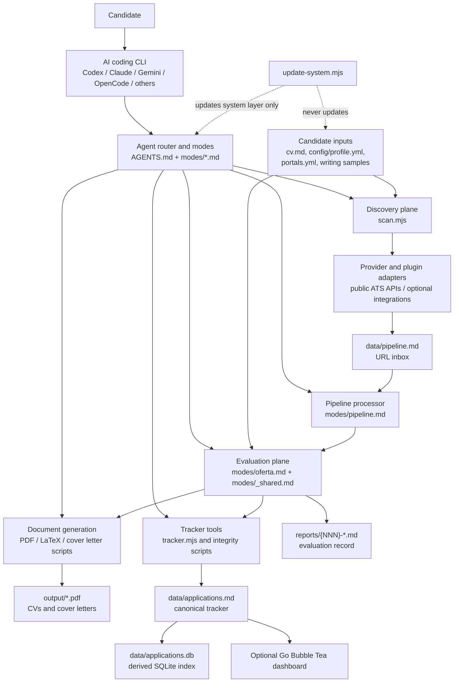

# Project Analysis: Career-Ops

## Executive summary

Career-Ops is a local-first job-search operating system. It combines Markdown instructions that an AI coding CLI follows with deterministic Node.js utilities and an optional Go terminal dashboard. The intended product loop is:

1. discover or paste a job opportunity;
2. validate that the posting is live;
3. evaluate it against the candidate profile and CV;
4. create a report and, when warranted, a tailored CV or cover letter;
5. update a canonical application tracker that the dashboard can browse.

The central design boundary is intentional: system-owned code, prompts, templates, and dashboard files may be updated, while candidate data, reports, pipeline state, and generated artefacts must not be overwritten. See [DATA_CONTRACT.md](../DATA_CONTRACT.md).

## Architecture diagram



## Components and responsibilities

| Component | Responsibility | Evidence |
|---|---|---|
| AI CLI and Markdown modes | Supplies the reasoning workflow, scoring criteria, candidate-facing guidance, and human approval rules. | [modes/_shared.md](../modes/_shared.md), [modes/oferta.md](../modes/oferta.md) |
| `scan.mjs` | Loads configured providers, filters and deduplicates offers, optionally validates liveness, then appends qualified offers to the pipeline and scan history. | [scan.mjs](../scan.mjs) (lines 60, 863) |
| Evaluation modes | Run the A-G evaluation: role summary, CV match, level strategy, compensation research, customisation, interview preparation, and posting legitimacy. | [modes/oferta.md](../modes/oferta.md) (line 31) |
| Tracker and integrity scripts | Treat Markdown as the canonical tracker, support a derived SQLite index, and validate statuses, duplicates, links, scores, and queued additions. | [tracker.mjs](../tracker.mjs) (line 500), [verify-pipeline.mjs](../verify-pipeline.mjs) (line 3) |
| PDF renderer | Uses Playwright Chromium to turn HTML into ATS-oriented PDFs and records tracker/report linkage. | [generate-pdf.mjs](../generate-pdf.mjs) (line 4) |
| Go dashboard | Reads the tracker, computes metrics, presents pipeline/report/progress views, and updates statuses through the UI. | [dashboard/main.go](../dashboard/main.go) (lines 19, 37) |
| Safe updater | Updates the declared system layer and explicitly protects CV, profile, pipeline data, and reports. | [update-system.mjs](../update-system.mjs) (line 4), [DATA_CONTRACT.md](../DATA_CONTRACT.md) (line 5) |

## Intended runtime flow

### 1. Discovery

`scan.mjs` reads `portals.yml` and the candidate profile, resolves a provider for each company or job board, fetches jobs concurrently, applies title/location/salary/content filters, removes duplicates and re-application cooldown hits, and optionally runs a Playwright liveness check. Qualified postings are appended to `data/pipeline.md`; history is written to `data/scan-history.tsv`. This is deterministic work intended to avoid consuming model tokens.

### 2. Evaluation and decision support

For a pasted job description or a pipeline entry, the AI CLI follows the evaluation mode. The mode instructs it to classify the role, score fit, check legitimacy, draft an application strategy, and create a detailed report. The system is decision support, not an autonomous application sender: the human makes the actual application decision.

### 3. Assets and tracking

The evaluation produces a numbered report and may produce an ATS-safe PDF. `data/applications.md` is the source of truth for application state. `tracker.mjs` can rebuild the SQLite index after tracker changes, while `verify-pipeline.mjs` checks the data invariants before the information is trusted downstream.

### 4. Visibility and maintenance

The optional Go dashboard reads application records and reports into a terminal UI. Separately, `update-system.mjs` is the controlled maintenance boundary: it may replace packaged system assets but must leave the user's personal employment data untouched.

## Important design choices

- **Markdown-first agent logic:** the evaluation behaviour lives in versioned `modes/*.md`, so the system can operate through several AI coding CLIs without embedding one LLM vendor into the runtime.
- **Local-first persistence:** candidate data and outputs are normal files, making them inspectable and portable. The SQLite database is explicitly derived rather than authoritative.
- **Human-in-the-loop:** evaluation, drafting, and tracker updates are automated; submitting an application is deliberately outside the automation boundary.
- **Defence in depth for job data:** liveness checks, input filters, deduplication, re-application cooldowns, and a posting-legitimacy assessment limit wasted evaluation work and unsafe inputs.
- **System/user separation:** update safety is a product requirement, not merely a convention. The data contract and updater tests exist to keep product upgrades from damaging a candidate's work.

## Current checkout health: material blocker

This analysis describes both the intended architecture and the files present in this working tree. The current checkout is not runnable end-to-end:

- `scan.mjs` imports `providers/_http.mjs`, `providers/_trust-validator.mjs`, and `plugins/_engine.mjs` ([scan.mjs](../scan.mjs), line 38), but the `providers/` and `plugins/` directories are absent in this working tree.
- The scanner therefore cannot reach its provider-loading stage successfully, even though it is designed to stop if zero providers are available ([scan.mjs](../scan.mjs), line 882).
- Several other system files are also deleted or missing, including `templates/portals.example.yml`; existing documentation should not claim the current checkout has a functional provider/plugin subsystem until that migration is completed or reverted.
- The installed `node_modules` tree is incomplete: the suite cannot resolve `playwright` or `js-yaml` from expected package paths.

## Verification performed

`node test-all.mjs` was run on 2026-07-27. It exited with status 1. The suite completed syntax checks but failed end-to-end checks because required source and dependency files are missing. Representative exact failures:

```text
❌ local-parser provider module is missing
❌ scan.mjs formatPipelineOffer import failed: Cannot find package '.../node_modules/js-yaml/index.js'
❌ PDF manifest path helper test crashed: Cannot find package '.../node_modules/playwright/index.js'
Error: ENOENT: no such file or directory, open '.../templates/portals.example.yml'
```

The highest-priority corrective action is to resolve the in-progress deletion/migration of `providers/`, `plugins/`, templates, and related scripts, then restore dependencies with the repository's package manager before treating the scanner or full test suite as operational.

## Documentation coverage audit

Existing documentation is broad but has drift:

| Area | Status | Assessment |
|---|---|---|
| Reference | Present | `README.md`, `DATA_CONTRACT.md`, scripts documentation, and architecture pages explain the public surface. |
| How-to | Present | Setup, CLI-specific, budget, and customisation guides exist under `docs/`. |
| Tutorial | Partial | The README quick start is a compact onboarding path, but there is no dedicated end-to-end tutorial for discovery through application tracking. |
| Explanation | Present but stale | `ARCHITECTURE.md` and `docs/ARCHITECTURE.md` explain the design, yet they refer to provider/plugin paths missing from the current checkout. |

The immediate documentation task is not more prose. It is restoring code/repository consistency, then reconciling the two architecture documents so one remains authoritative.
